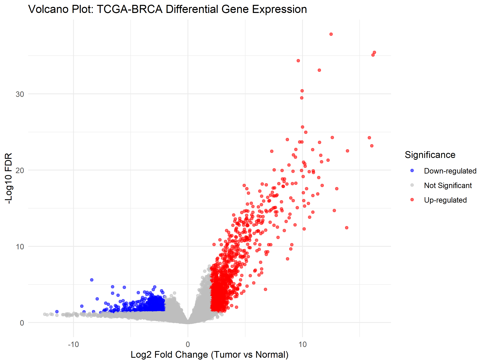

# TCGA-BRCA Bulk RNA-Seq Differential Gene Expression Analysis

This repository contains a bulk RNA-seq differential gene expression (DGE) pipeline analyzing **Breast Invasive Carcinoma (TCGA-BRCA)** samples comparing Primary Tumor versus Solid Tissue Normal samples.

## Workflow Overview
1. **Data Acquisition:** Query and download transcriptomic counts using `TCGAbiolinks`[cite: 1, 4].
2. **Filtering & Normalization:** Low-expressed genes filtered via `filterByExpr` and TMM-normalized using `edgeR::normLibSizes`.
3. **Statistical Testing:** Generalized Linear Model (GLM) Quasi-Likelihood F-test (`glmQLFit` / `glmQLFTest`) to identify significantly mutated/expressed genes.
4. **Annotation & Visualization:** Ensembl IDs mapped to HGNC Symbols via `org.Hs.eg.db`[cite: 5] and visualized with `ggplot2` volcano plots[cite: 5].

## Repository Contents
- `TCGA_BRCA_DEG_results_with_symbols.csv`: Full differential expression results with LogFC, P-values, FDR, and Gene Symbols[cite: 5].
- `TCGA_BRCA_Volcano_Plot.png`: High-resolution volcano plot highlighting up-regulated (Red) and down-regulated (Blue) genes[cite: 5].

## Results Preview
